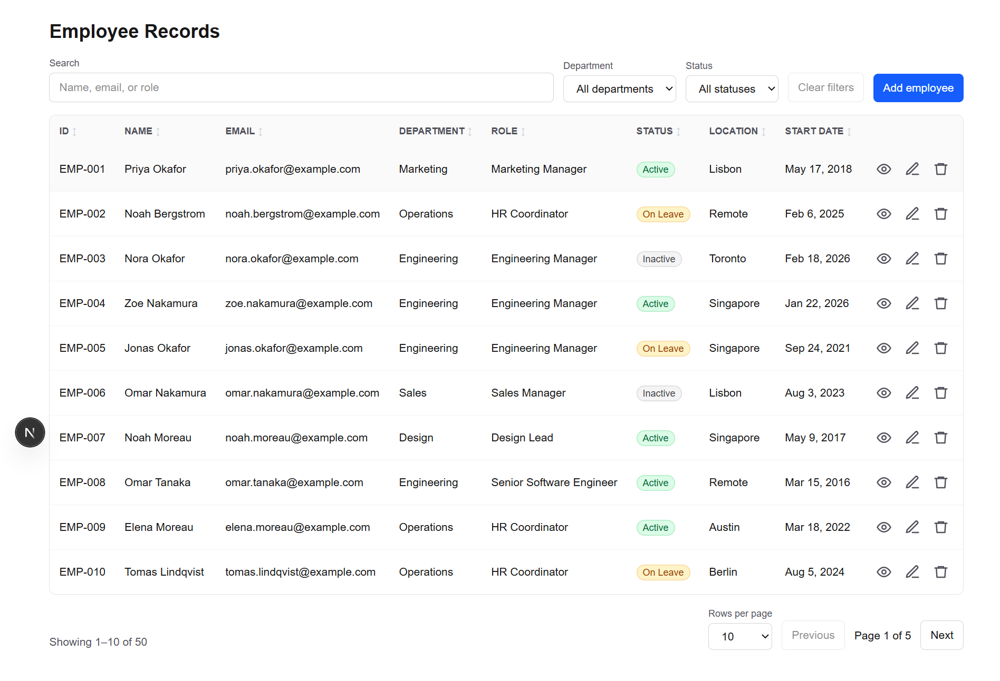
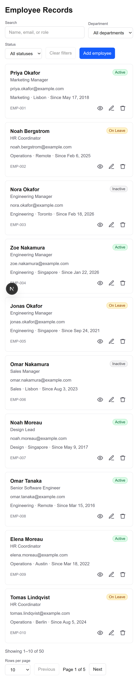

# Records Dashboard

Internal employee records dashboard: a sortable, filterable data table with add, edit and delete, built on mock data.

**Live demo:** https://records-dashboard-phi.vercel.app/

|                       Desktop                       |                      Mobile                      |
| :-------------------------------------------------: | :----------------------------------------------: |
|  |  |

## Stack

- Next.js (App Router) + TypeScript (strict)
- Tailwind CSS
- TanStack Table v8
- react-hook-form + Zod
- ESLint + Prettier

## Features

- Sortable columns (asc, desc, none) with status badges
- Debounced global search across name, email and role
- Department and status filters with a clear-filters button
- Pagination with a rows-per-page select and result count
- Detail drawer: closes on ESC, backdrop click or the close button, with focus trapped while open
- Add and edit in one modal form with inline Zod validation: name 2–80 characters, valid and unique email, required fields, start date at most 1 year ahead
- Delete with a confirm dialog and toast confirmations
- Responsive: stacked cards below 768px, loading skeleton, empty and no-results states
- Accessible: table semantics, labeled controls, keyboard support, visible focus

## Run locally

```bash
npm install
npm run dev
```

Open http://localhost:3000.

| Script                 | Purpose               |
| ---------------------- | --------------------- |
| `npm run build`        | Production build      |
| `npm run lint`         | ESLint, zero warnings |
| `npm run format`       | Format with Prettier  |
| `npm run format:check` | Check formatting      |

## Project structure

```
app/                 Next.js routes
components/table/    Table, columns, toolbar, pagination, cards
components/forms/    Employee form and field components
components/ui/       Badge, Drawer, Modal, Select, Toast, ...
lib/                 Zod schema, data loader, hooks
data/                Static mock employees (50 rows)
```

The Zod schema in `lib/schema.ts` is the single source of truth for types and validation. Data is loaded through `lib/data.ts` with a simulated 500ms delay; edits live in client state and reset on reload.

Mock data only; built with Claude Code, all code reviewed and tested manually.
